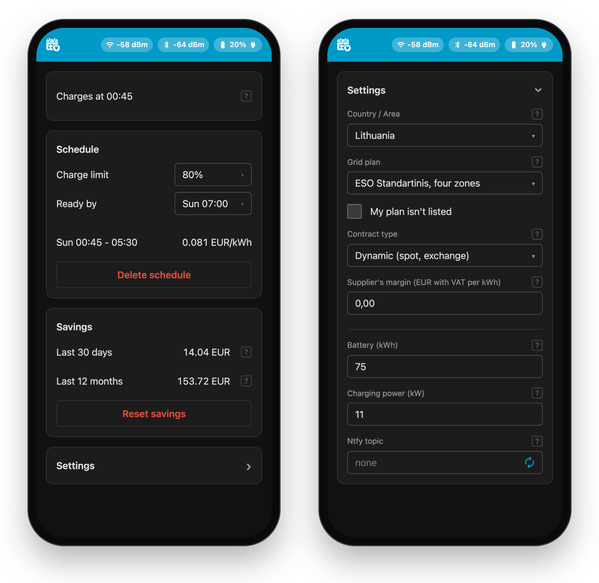
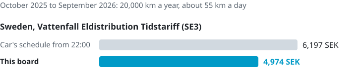
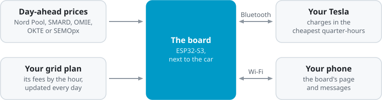
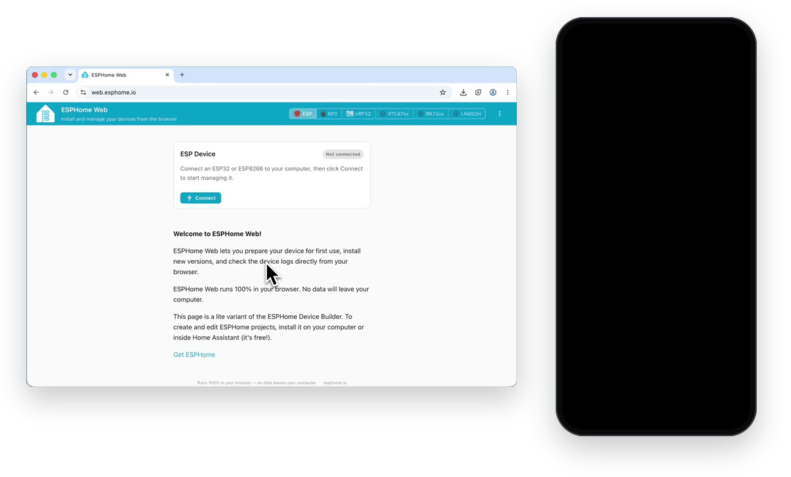

<div align="center">


# ESPHome Tesla BLE Scheduler

**Charge your Tesla in the cheapest hours of the night, automatically.**<br>
A small ESP32 board by the car follows the electricity market and controls charging over Bluetooth.

[](https://github.com/zygimantas/esphome-tesla-ble-scheduler/releases/latest)
[](https://github.com/zygimantas/esphome-tesla-ble-scheduler/actions/workflows/ci.yml)
[](LICENSE)

[Install](#install) · [How it works](#how-it-works) · [Countries](plans/README.md) · [User guide](docs/guide.md) · [Contributing](CONTRIBUTING.md)



</div>

## Why

Day-ahead electricity prices change every quarter-hour, and the cheapest hours of a night often cost a fraction of the evening peak. A Tesla's own schedule knows times, not prices, and the tools that follow prices usually need a cloud service, your Tesla account, Home Assistant or a new charger.

This board needs none of them. When you plug in, it picks the cheapest quarter-hours that still get the car to its charge limit by the time you leave, counting your grid fees and VAT.

- **Runs at home:** no cloud, no Tesla account, no subscription, no Home Assistant.
- **Can only charge:** its key can't unlock the doors or drive the car.
- **Works in 26 European countries,** most with their grid operators' plans built in.
- **Updates from its own page,** with releases signed by the project.

## Example of yearly savings

Worked out on the market prices of every night from October 2025, when they went to quarter-hours, to September 2026, for one driver, the same in every country:

- **The car:** a 75 kWh Tesla that drives 20,000 km a year, about 55 km a day, at 15 kWh per 100 km.
- **Every night:** plugged in from 18:00 to 07:00, charging at 11 kW.
- **The driver already saves:** the Tesla's own scheduler starts charging at the same time every night, when cheap hours usually begin.
- **The contract:** a price that changes every hour with the market, called dynamic or spot, or the usual price where homes can't have one.
- **Full prices:** each kWh costs what the bill would say, with grid fees, taxes and VAT.

<picture>
  <source media="(prefers-color-scheme: dark)" srcset="docs/images/savings-dark.svg">
  
</picture>

That's 20% less, 1,223 SEK saved a year, as the board finds the cheap quarter-hours wherever they fall each night.

### Every country

Open your country for what charging cost a year on each grid plan, on the car's own night schedule and with this board. Confidence says how many homes there pay such prices.

<table>
<tr><td>🟢 <b>Worth it</b></td><td>A plan saves 15% or more, with high or medium confidence</td></tr>
<tr><td>🟡 <b>Maybe</b></td><td>Less than that, or low confidence</td></tr>
<tr><td>⚪ <b>Nothing</b></td><td>Homes pay regulated or fixed prices, where a night schedule does as well</td></tr>
</table>

<details>
<summary>🟡 <b>Austria</b></summary>
<p></p>

| Grid plan | Car's schedule from | Car's schedule | This board | Saved a year |
| --- | ---: | ---: | ---: | ---: |
| Energie Klagenfurt | 00:00 | 886 EUR | 841 EUR | 45 EUR, 5% |
| Energienetze Steiermark | 00:00 | 953 EUR | 908 EUR | 45 EUR, 5% |
| Innsbrucker Kommunalbetriebe | 00:00 | 926 EUR | 881 EUR | 45 EUR, 5% |
| KNG-Kärnten Netz | 00:00 | 988 EUR | 944 EUR | 45 EUR, 5% |
| LINZ NETZ | 00:00 | 829 EUR | 784 EUR | 45 EUR, 5% |
| Netz Burgenland | 00:00 | 925 EUR | 880 EUR | 45 EUR, 5% |
| Netz Niederösterreich | 00:00 | 954 EUR | 909 EUR | 45 EUR, 5% |
| Netz Oberösterreich | 00:00 | 859 EUR | 815 EUR | 45 EUR, 5% |
| Salzburg Netz | 00:00 | 864 EUR | 820 EUR | 45 EUR, 5% |
| Stromnetz Graz | 00:00 | 820 EUR | 775 EUR | 45 EUR, 5% |
| TINETZ-Tiroler Netze | 00:00 | 871 EUR | 826 EUR | 45 EUR, 5% |
| Vorarlberger Energienetze | 00:00 | 801 EUR | 756 EUR | 45 EUR, 6% |
| Wiener Netze | 00:00 | 954 EUR | 907 EUR | 48 EUR, 5% |

Low confidence: about 1% of homes paid the market price in 2025. [The research](plans/at/AGENTS.md)

</details>

<details>
<summary>🟡 <b>Belgium</b></summary>
<p></p>

| Grid plan | Car's schedule from | Car's schedule | This board | Saved a year |
| --- | ---: | ---: | ---: | ---: |
| Fluvius Antwerpen, digital meter | 00:00 | 839 EUR | 783 EUR | 56 EUR, 7% |
| Fluvius Halle-Vilvoorde, digital meter | 00:00 | 851 EUR | 796 EUR | 56 EUR, 7% |
| Fluvius Imewo, digital meter | 00:00 | 847 EUR | 792 EUR | 56 EUR, 7% |
| Fluvius Kempen, digital meter | 00:00 | 849 EUR | 793 EUR | 56 EUR, 7% |
| Fluvius Limburg, digital meter | 00:00 | 838 EUR | 782 EUR | 56 EUR, 7% |
| Fluvius Midden-Vlaanderen, digital meter | 00:00 | 844 EUR | 788 EUR | 56 EUR, 7% |
| Fluvius West, digital meter | 00:00 | 855 EUR | 799 EUR | 56 EUR, 7% |
| Fluvius Zenne-Dijle, digital meter | 00:00 | 851 EUR | 796 EUR | 56 EUR, 7% |
| ORES Bihoraire, two rates | 22:00 | 1,000 EUR | 878 EUR | 122 EUR, 12% |
| ORES Impact, three rates | 01:00 | 831 EUR | 799 EUR | 31 EUR, 4% |
| ORES Monohoraire, one rate | 00:00 | 1,081 EUR | 1,025 EUR | 56 EUR, 5% |
| RESA Bihoraire, two rates | 22:00 | 979 EUR | 858 EUR | 122 EUR, 12% |
| RESA Impact, three rates | 01:00 | 819 EUR | 788 EUR | 31 EUR, 4% |
| RESA Monohoraire, one rate | 00:00 | 1,043 EUR | 987 EUR | 56 EUR, 5% |
| Sibelga Bihoraire, two rates | 22:00 | 949 EUR | 823 EUR | 126 EUR, 13% |
| Sibelga Monohoraire, one rate | 00:00 | 958 EUR | 902 EUR | 56 EUR, 6% |

Low confidence: 0.4% of homes pay the market price, and Flanders' fee per kW isn't counted. [The research](plans/be/AGENTS.md)

</details>

<details>
<summary>⚪ <b>Bulgaria</b></summary>
<p></p>

| Grid plan | Car's schedule from | Car's schedule | This board | Saved a year |
| --- | ---: | ---: | ---: | ---: |
| Regulated price, in ERM Zapad's area | 23:00 | 306 EUR | 306 EUR | nothing |

High confidence: nearly every home pays a regulated price, cheaper at night. [The research](plans/bg/AGENTS.md)

</details>

<details>
<summary>⚪ <b>Croatia</b></summary>
<p></p>

| Grid plan | Car's schedule from | Car's schedule | This board | Saved a year |
| --- | ---: | ---: | ---: | ---: |
| Regulated price, HEP ODS Bijeli | 22:00 | 338 EUR | 338 EUR | nothing |

High confidence: no home pays the market price, and the regulated one is cheaper at night. [The research](plans/hr/AGENTS.md)

</details>

<details>
<summary>🟡 <b>Czechia</b></summary>
<p></p>

| Grid plan | Car's schedule from | Car's schedule | This board | Saved a year |
| --- | ---: | ---: | ---: | ---: |
| ČEZ Distribuce D01d | 00:00 | 24,263 CZK | 23,141 CZK | 1,123 CZK, 5% |
| ČEZ Distribuce D02d | 00:00 | 21,892 CZK | 20,769 CZK | 1,123 CZK, 5% |
| ČEZ Distribuce D27d, interval meter | 20:00 | 18,634 CZK | 13,057 CZK | 5,578 CZK, 30% |
| ČEZ Distribuce D61d | 00:00 | 23,179 CZK | 20,523 CZK | 2,655 CZK, 11% |
| EG.D D01d | 00:00 | 24,443 CZK | 23,320 CZK | 1,123 CZK, 5% |
| EG.D D02d | 00:00 | 22,766 CZK | 21,643 CZK | 1,123 CZK, 5% |
| EG.D D61d | 00:00 | 23,477 CZK | 20,849 CZK | 2,628 CZK, 11% |
| PREdistribuce D01d | 00:00 | 20,989 CZK | 19,866 CZK | 1,123 CZK, 5% |
| PREdistribuce D02d | 00:00 | 19,625 CZK | 18,502 CZK | 1,123 CZK, 6% |
| PREdistribuce D61d | 00:00 | 20,467 CZK | 18,397 CZK | 2,070 CZK, 10% |

Low confidence: few homes pay the market price. [The research](plans/cz/AGENTS.md)

</details>

<details>
<summary>🟡 <b>Denmark</b></summary>
<p></p>

| Grid plan | Car's schedule from | Car's schedule | This board | Saved a year |
| --- | ---: | ---: | ---: | ---: |
| Cerius Nettarif C (DK2) | 00:00 | 4,575 DKK | 4,186 DKK | 389 DKK, 9% |
| Dinel Nettarif C (DK1) | 00:00 | 4,394 DKK | 3,996 DKK | 398 DKK, 9% |
| Konstant Nettarif C (DK1) | 00:00 | 4,344 DKK | 3,938 DKK | 406 DKK, 9% |
| N1 Nettarif C (DK1) | 00:00 | 4,504 DKK | 4,118 DKK | 387 DKK, 9% |
| Nord Energi Net Nettarif C (DK1) | 00:00 | 4,443 DKK | 4,050 DKK | 393 DKK, 9% |
| Radius Elnet Nettarif C (DK2) | 00:00 | 4,537 DKK | 4,146 DKK | 391 DKK, 9% |
| TREFOR El-net Nettarif C (DK1) | 00:00 | 4,317 DKK | 3,908 DKK | 409 DKK, 9% |
| Vores Elnet Nettarif C (DK1) | 00:00 | 4,459 DKK | 4,066 DKK | 392 DKK, 9% |

High confidence: most homes pay the market price. [The research](plans/dk/AGENTS.md)

</details>

<details>
<summary>🟢 <b>Estonia</b></summary>
<p></p>

| Grid plan | Car's schedule from | Car's schedule | This board | Saved a year |
| --- | ---: | ---: | ---: | ---: |
| Elektrilevi Võrk 1, up to 63 A | 00:00 | 682 EUR | 604 EUR | 79 EUR, 12% |
| Elektrilevi Võrk 2, up to 63 A | 22:00 | 645 EUR | 433 EUR | 212 EUR, 33% |
| Elektrilevi Võrk 4, up to 63 A | 22:00 | 586 EUR | 374 EUR | 213 EUR, 36% |
| Elektrilevi Võrk 5, up to 63 A | 22:00 | 625 EUR | 413 EUR | 212 EUR, 34% |

High confidence: exchange-price packages are common. [The research](plans/ee/AGENTS.md)

</details>

<details>
<summary>🟢 <b>Finland</b></summary>
<p></p>

| Grid plan | Car's schedule from | Car's schedule | This board | Saved a year |
| --- | ---: | ---: | ---: | ---: |
| Caruna Espoo Kausisiirto | 22:00 | 400 EUR | 300 EUR | 100 EUR, 25% |
| Caruna Espoo Yleissiirto | 00:00 | 375 EUR | 347 EUR | 28 EUR, 7% |
| Caruna Espoo Yösiirto | 22:00 | 393 EUR | 294 EUR | 99 EUR, 25% |
| Caruna Kausisiirto | 22:00 | 462 EUR | 362 EUR | 100 EUR, 22% |
| Caruna Yleissiirto | 00:00 | 457 EUR | 430 EUR | 28 EUR, 6% |
| Caruna Yösiirto | 22:00 | 459 EUR | 360 EUR | 99 EUR, 22% |
| Elenia Vuodenaikasiirto | 22:00 | 447 EUR | 347 EUR | 100 EUR, 22% |
| Elenia Yleissiirto | 00:00 | 478 EUR | 451 EUR | 28 EUR, 6% |
| Elenia Yösiirto | 22:00 | 447 EUR | 348 EUR | 99 EUR, 22% |
| Helen Sähköverkko Aikasiirto | 22:00 | 407 EUR | 308 EUR | 99 EUR, 24% |
| Helen Sähköverkko Yleissiirto | 00:00 | 439 EUR | 412 EUR | 28 EUR, 6% |
| Oulun Energia Aikasähkö | 22:00 | 409 EUR | 310 EUR | 99 EUR, 24% |
| Oulun Energia Kausisähkö | 22:00 | 420 EUR | 320 EUR | 100 EUR, 24% |
| Oulun Energia Yleissähkö | 00:00 | 388 EUR | 360 EUR | 28 EUR, 7% |
| Savon Voima Aikasähkö | 22:00 | 458 EUR | 358 EUR | 100 EUR, 22% |
| Savon Voima Yleissähkö | 00:00 | 456 EUR | 428 EUR | 28 EUR, 6% |
| Tampereen Energia Aikasiirto | 22:00 | 402 EUR | 303 EUR | 99 EUR, 25% |
| Tampereen Energia Kausisiirto | 22:00 | 435 EUR | 335 EUR | 100 EUR, 23% |
| Tampereen Energia Yleissiirto | 00:00 | 391 EUR | 363 EUR | 28 EUR, 7% |
| Vantaan Energia Aikasiirto | 22:00 | 409 EUR | 310 EUR | 99 EUR, 24% |
| Vantaan Energia Kausisiirto | 22:00 | 445 EUR | 345 EUR | 100 EUR, 23% |
| Vantaan Energia Kerrostalosiirto | 00:00 | 386 EUR | 358 EUR | 28 EUR, 7% |
| Vantaan Energia Yleissiirto | 00:00 | 392 EUR | 365 EUR | 28 EUR, 7% |

High confidence: a third of homes pay the market price. [The research](plans/fi/AGENTS.md)

</details>

<details>
<summary>🟡 <b>France</b></summary>
<p></p>

| Grid plan | Car's schedule from | Car's schedule | This board | Saved a year |
| --- | ---: | ---: | ---: | ---: |
| TURPE CU4, off-peak 22:00 - 06:00 | 22:00 | 732 EUR | 561 EUR | 171 EUR, 23% |

Low confidence: two small suppliers bill the market price, and off-peak hours differ by address. [The research](plans/fr/AGENTS.md)

</details>

<details>
<summary>🟡 <b>Germany</b></summary>
<p></p>

| Grid plan | Car's schedule from | Car's schedule | This board | Saved a year |
| --- | ---: | ---: | ---: | ---: |
| Avacon Netz Modul 2, separate meter | 00:00 | 866 EUR | 783 EUR | 83 EUR, 10% |
| Avacon Netz Modul 3, three rates | 23:00 | 924 EUR | 820 EUR | 105 EUR, 11% |
| Avacon Netz, standard | 00:00 | 1,010 EUR | 927 EUR | 83 EUR, 8% |
| Bayernwerk Netz Modul 2, separate meter | 00:00 | 845 EUR | 762 EUR | 83 EUR, 10% |
| Bayernwerk Netz Modul 3, three rates | 22:00 | 1,037 EUR | 889 EUR | 148 EUR, 14% |
| Bayernwerk Netz, standard | 00:00 | 957 EUR | 874 EUR | 83 EUR, 9% |
| EAM Netz Modul 2, separate meter | 00:00 | 857 EUR | 774 EUR | 83 EUR, 10% |
| EAM Netz Modul 3, three rates | 23:00 | 857 EUR | 773 EUR | 84 EUR, 10% |
| EAM Netz, standard | 00:00 | 987 EUR | 904 EUR | 83 EUR, 8% |
| E.DIS Netz Modul 2, separate meter | 00:00 | 857 EUR | 774 EUR | 83 EUR, 10% |
| E.DIS Netz Modul 3, three rates | 23:30 | 893 EUR | 808 EUR | 85 EUR, 10% |
| E.DIS Netz, standard | 00:00 | 987 EUR | 904 EUR | 83 EUR, 8% |
| EWE NETZ Modul 2, separate meter | 00:00 | 821 EUR | 738 EUR | 83 EUR, 10% |
| EWE NETZ Modul 3, three rates | 23:00 | 805 EUR | 719 EUR | 86 EUR, 11% |
| EWE NETZ, standard | 00:00 | 897 EUR | 814 EUR | 83 EUR, 9% |
| Hamburger Energienetze Modul 2 | 00:00 | 924 EUR | 841 EUR | 83 EUR, 9% |
| Hamburger Energienetze Modul 3 | 00:30 | 903 EUR | 863 EUR | 41 EUR, 5% |
| Hamburger Energienetze, standard | 00:00 | 1,155 EUR | 1,072 EUR | 83 EUR, 7% |
| MITNETZ STROM Modul 2, separate meter | 00:00 | 870 EUR | 787 EUR | 83 EUR, 10% |
| MITNETZ STROM Modul 3, three rates | 19:00 | 1,078 EUR | 831 EUR | 247 EUR, 23% |
| MITNETZ STROM, standard | 00:00 | 1,020 EUR | 937 EUR | 83 EUR, 8% |
| N-ERGIE Netz Modul 2, separate meter | 00:00 | 864 EUR | 781 EUR | 83 EUR, 10% |
| N-ERGIE Netz Modul 3, three rates | 23:00 | 887 EUR | 803 EUR | 84 EUR, 9% |
| N-ERGIE Netz, standard | 00:00 | 1,006 EUR | 923 EUR | 83 EUR, 8% |
| Netze BW Modul 2, separate meter | 00:00 | 890 EUR | 807 EUR | 83 EUR, 9% |
| Netze BW Modul 3, three rates | 22:00 | 1,150 EUR | 1,001 EUR | 150 EUR, 13% |
| Netze BW, standard | 00:00 | 1,070 EUR | 987 EUR | 83 EUR, 8% |
| RheinNetz Modul 2, separate meter | 00:00 | 830 EUR | 747 EUR | 83 EUR, 10% |
| RheinNetz Modul 3, three rates | 23:45 | 815 EUR | 751 EUR | 64 EUR, 8% |
| RheinNetz, standard | 00:00 | 920 EUR | 837 EUR | 83 EUR, 9% |
| Stromnetz Berlin Modul 2, separate meter | 00:00 | 888 EUR | 805 EUR | 83 EUR, 9% |
| Stromnetz Berlin Modul 3, three rates | 22:15 | 928 EUR | 812 EUR | 117 EUR, 13% |
| Stromnetz Berlin, standard | 00:00 | 1,066 EUR | 983 EUR | 83 EUR, 8% |
| SWM Infrastruktur Modul 2, separate meter | 00:00 | 873 EUR | 790 EUR | 83 EUR, 10% |
| SWM Infrastruktur Modul 3, three rates | 00:45 | 926 EUR | 869 EUR | 57 EUR, 6% |
| SWM Infrastruktur, standard | 00:00 | 1,027 EUR | 944 EUR | 83 EUR, 8% |
| Westnetz Modul 2, separate meter | 00:00 | 921 EUR | 838 EUR | 83 EUR, 9% |
| Westnetz Modul 3, three rates | 00:00 | 808 EUR | 747 EUR | 61 EUR, 8% |
| Westnetz, standard | 00:00 | 1,148 EUR | 1,065 EUR | 83 EUR, 7% |

Low confidence: dynamic contracts and Modul 3 need a smart meter, and 6% of meters are one. [The research](plans/de/AGENTS.md)

</details>

<details>
<summary>⚪ <b>Hungary</b></summary>
<p></p>

| Grid plan | Car's schedule from | Car's schedule | This board | Saved a year |
| --- | ---: | ---: | ---: | ---: |
| A2 on the car's own meter, ELMŰ | 23:00 | 137,960 HUF | 137,960 HUF | nothing |

Medium confidence: homes pay regulated prices, and the car's own meter (A2) pays less at night. [The research](plans/hu/AGENTS.md)

</details>

<details>
<summary>⚪ <b>Ireland</b></summary>
<p></p>

| Grid plan | Car's schedule from | Car's schedule | This board | Saved a year |
| --- | ---: | ---: | ---: | ---: |
| Electric Ireland Night Boost | 02:00 | 363 EUR | 363 EUR | nothing |

High confidence: electric car owners usually take a fixed plan with a cheap night, cheaper than dynamic contracts. [The research](plans/ie/AGENTS.md)

</details>

<details>
<summary>🟡 <b>Italy</b></summary>
<p></p>

| Grid plan | Car's schedule from | Car's schedule | This board | Saved a year |
| --- | ---: | ---: | ---: | ---: |
| TD transport and meter charges | 00:00 | 971 EUR | 926 EUR | 45 EUR, 5% |

Medium confidence: about 3% of homes pay the hourly price. [The research](plans/it/AGENTS.md)

</details>

<details>
<summary>🟢 <b>Latvia</b></summary>
<p></p>

| Grid plan | Car's schedule from | Car's schedule | This board | Saved a year |
| --- | ---: | ---: | ---: | ---: |
| Sadales tīkls Pamata | 00:00 | 561 EUR | 418 EUR | 142 EUR, 25% |
| Sadales tīkls Speciālais | 00:00 | 1,040 EUR | 898 EUR | 142 EUR, 14% |

High confidence: one home in six pays the market price. [The research](plans/lv/AGENTS.md)

</details>

<details>
<summary>🟢 <b>Lithuania</b></summary>
<p></p>

| Grid plan | Car's schedule from | Car's schedule | This board | Saved a year |
| --- | ---: | ---: | ---: | ---: |
| ESO Efektyvus, one zone | 00:00 | 734 EUR | 593 EUR | 141 EUR, 19% |
| ESO Efektyvus, two zones | 00:00 | 629 EUR | 502 EUR | 127 EUR, 20% |
| ESO Efektyvus, four zones | 22:00 | 745 EUR | 492 EUR | 254 EUR, 34% |
| ESO Namai, one zone | 00:00 | 758 EUR | 617 EUR | 141 EUR, 19% |
| ESO Namai, two zones | 00:00 | 646 EUR | 519 EUR | 127 EUR, 20% |
| ESO Standartinis, one zone | 00:00 | 811 EUR | 670 EUR | 141 EUR, 17% |
| ESO Standartinis, two zones | 00:00 | 678 EUR | 552 EUR | 126 EUR, 19% |
| ESO Standartinis, four zones | 22:00 | 786 EUR | 536 EUR | 250 EUR, 32% |

Medium confidence: a few percent of homes pay each quarter-hour's price, most a fixed one. [The research](plans/lt/AGENTS.md)

</details>

<details>
<summary>🟡 <b>Luxembourg</b></summary>
<p></p>

| Grid plan | Car's schedule from | Car's schedule | This board | Saved a year |
| --- | ---: | ---: | ---: | ---: |
| Network fee, standard client | 00:00 | 652 EUR | 602 EUR | 49 EUR, 8% |

Low confidence: few homes pay the market price. [The research](plans/lu/AGENTS.md)

</details>

<details>
<summary>🟡 <b>Netherlands</b></summary>
<p></p>

| Grid plan | Car's schedule from | Car's schedule | This board | Saved a year |
| --- | ---: | ---: | ---: | ---: |
| No grid fee per kWh | 00:00 | 877 EUR | 817 EUR | 60 EUR, 7% |

High confidence: 8% of homes pay the market price. [The research](plans/nl/AGENTS.md)

</details>

<details>
<summary>🟡 <b>Norway</b></summary>
<p></p>

| Grid plan | Car's schedule from | Car's schedule | This board | Saved a year |
| --- | ---: | ---: | ---: | ---: |
| Arva, households (NO4) | 22:00 | 1,804 NOK | 1,545 NOK | 260 NOK, 14% |
| BKK, households (NO5) | 22:00 | 4,189 NOK | 3,968 NOK | 221 NOK, 5% |
| Elvia, households (NO1) | 22:00 | 4,520 NOK | 4,243 NOK | 276 NOK, 6% |
| Fagne, households (NO2) | 22:00 | 4,709 NOK | 4,440 NOK | 269 NOK, 6% |
| Glitre Nett, households (NO2) | 22:00 | 4,537 NOK | 4,293 NOK | 244 NOK, 5% |
| Lede, households (NO1) | 00:00 | 4,176 NOK | 3,999 NOK | 176 NOK, 4% |
| Lnett, households (NO2) | 22:00 | 4,443 NOK | 4,172 NOK | 271 NOK, 6% |
| Tensio TN, households (NO3) | 22:00 | 3,874 NOK | 3,634 NOK | 240 NOK, 6% |
| Tensio TS, households (NO3) | 22:00 | 3,757 NOK | 3,513 NOK | 244 NOK, 6% |

Medium confidence: most homes' power is at Norgespris, a fixed price, where the car's own schedule does as well. [The research](plans/no/AGENTS.md)

</details>

<details>
<summary>🟡 <b>Poland</b></summary>
<p></p>

| Grid plan | Car's schedule from | Car's schedule | This board | Saved a year |
| --- | ---: | ---: | ---: | ---: |
| Enea Operator G11 | 00:00 | 3,608 PLN | 3,421 PLN | 186 PLN, 5% |
| Enea Operator G12w | 22:00 | 3,217 PLN | 2,737 PLN | 480 PLN, 15% |
| Energa-Operator G11 | 00:00 | 4,030 PLN | 3,843 PLN | 186 PLN, 5% |
| Energa-Operator G12 | 23:00 | 2,986 PLN | 2,746 PLN | 240 PLN, 8% |
| Energa-Operator G12w | 23:00 | 2,996 PLN | 2,748 PLN | 248 PLN, 8% |
| PGE Dystrybucja G11 | 00:00 | 4,023 PLN | 3,837 PLN | 186 PLN, 5% |
| PGE Dystrybucja G12 | 23:00 | 2,961 PLN | 2,721 PLN | 240 PLN, 8% |
| PGE Dystrybucja G12w | 23:00 | 2,993 PLN | 2,746 PLN | 248 PLN, 8% |
| Stoen Operator G11 | 00:00 | 3,561 PLN | 3,374 PLN | 186 PLN, 5% |
| Stoen Operator G12 | 23:00 | 2,875 PLN | 2,633 PLN | 242 PLN, 8% |
| Stoen Operator G12w | 23:00 | 3,089 PLN | 2,843 PLN | 247 PLN, 8% |
| Tauron Dystrybucja G11 | 00:00 | 3,611 PLN | 3,424 PLN | 186 PLN, 5% |
| Tauron Dystrybucja G12 | 23:00 | 2,876 PLN | 2,635 PLN | 241 PLN, 8% |
| Tauron Dystrybucja G12w | 23:00 | 2,857 PLN | 2,609 PLN | 248 PLN, 9% |

Low confidence: 0.03% of homes have a dynamic contract, and it bills another auction's price. [The research](plans/pl/AGENTS.md)

</details>

<details>
<summary>🟡 <b>Portugal</b></summary>
<p></p>

| Grid plan | Car's schedule from | Car's schedule | This board | Saved a year |
| --- | ---: | ---: | ---: | ---: |
| Bi-horária, ciclo diário | 22:00 | 680 EUR | 568 EUR | 112 EUR, 16% |
| Bi-horária, ciclo semanal | 00:00 | 627 EUR | 548 EUR | 79 EUR, 13% |
| Simples | 00:00 | 812 EUR | 694 EUR | 118 EUR, 15% |
| Tri-horária, ciclo diário | 22:00 | 680 EUR | 541 EUR | 139 EUR, 20% |
| Tri-horária, ciclo semanal | 00:00 | 627 EUR | 532 EUR | 96 EUR, 15% |

Low confidence: under 1% of homes pay the market price. [The research](plans/pt/AGENTS.md)

</details>

<details>
<summary>🟡 <b>Romania</b></summary>
<p></p>

| Grid plan | Car's schedule from | Car's schedule | This board | Saved a year |
| --- | ---: | ---: | ---: | ---: |
| DEER, low voltage | 00:00 | 5,704 RON | 4,899 RON | 806 RON, 14% |
| Delgaz Grid, low voltage | 00:00 | 5,836 RON | 5,030 RON | 806 RON, 14% |
| Distribuție Energie Oltenia, low voltage | 00:00 | 5,615 RON | 4,810 RON | 806 RON, 14% |
| Rețele Electrice România, low voltage | 00:00 | 5,551 RON | 4,746 RON | 806 RON, 15% |

Low confidence: no home had a dynamic contract in 2025. [The research](plans/ro/AGENTS.md)

</details>

<details>
<summary>⚪ <b>Slovakia</b></summary>
<p></p>

| Grid plan | Car's schedule from | Car's schedule | This board | Saved a year |
| --- | ---: | ---: | ---: | ---: |
| Regulated price, DD3 in ZSD's area | 23:30 | 509 EUR | 509 EUR | nothing |

High confidence: nearly every home pays a regulated price, cheaper at night. [The research](plans/sk/AGENTS.md)

</details>

<details>
<summary>🟡 <b>Slovenia</b></summary>
<p></p>

| Grid plan | Car's schedule from | Car's schedule | This board | Saved a year |
| --- | ---: | ---: | ---: | ---: |
| Network charge, user group 0 | 22:00 | 713 EUR | 593 EUR | 120 EUR, 17% |

Low confidence: 0.3% of homes pay the market price. [The research](plans/si/AGENTS.md)

</details>

<details>
<summary>🟢 <b>Spain</b></summary>
<p></p>

| Grid plan | Car's schedule from | Car's schedule | This board | Saved a year |
| --- | ---: | ---: | ---: | ---: |
| 2.0TD tolls and charges | 00:00 | 616 EUR | 476 EUR | 140 EUR, 23% |

High confidence: over a quarter of homes pay each hour's price, most on the regulated PVPC. [The research](plans/es/AGENTS.md)

</details>

<details>
<summary>🟢 <b>Sweden</b></summary>
<p></p>

| Grid plan | Car's schedule from | Car's schedule | This board | Saved a year |
| --- | ---: | ---: | ---: | ---: |
| Ellevio (SE3) | 00:00 | 5,384 SEK | 4,824 SEK | 560 SEK, 10% |
| Ellevio, single phase up to 20 A (SE3) | 00:00 | 6,184 SEK | 5,624 SEK | 560 SEK, 9% |
| E.ON Nord, 16-63 A (SE2) | 00:00 | 4,201 SEK | 3,846 SEK | 355 SEK, 8% |
| E.ON Nord, 16 A up to 8,000 kWh (SE2) | 00:00 | 6,558 SEK | 6,203 SEK | 355 SEK, 5% |
| E.ON Nord, apartment 16 A (SE2) | 00:00 | 6,964 SEK | 6,610 SEK | 355 SEK, 5% |
| E.ON Nord, apartment 20-25 A (SE2) | 00:00 | 6,383 SEK | 6,028 SEK | 355 SEK, 6% |
| E.ON Stockholm, 16-63 A (SE3) | 00:00 | 5,394 SEK | 4,834 SEK | 560 SEK, 10% |
| E.ON Stockholm, 16 A up to 8,000 kWh (SE3) | 00:00 | 6,757 SEK | 6,197 SEK | 560 SEK, 8% |
| E.ON Stockholm, apartment 16 A (SE3) | 00:00 | 7,212 SEK | 6,652 SEK | 560 SEK, 8% |
| E.ON Stockholm, apartment 20-25 A (SE3) | 00:00 | 6,757 SEK | 6,197 SEK | 560 SEK, 8% |
| E.ON Syd, 16-63 A (SE4) | 00:00 | 6,396 SEK | 5,586 SEK | 811 SEK, 13% |
| E.ON Syd, 16 A up to 8,000 kWh (SE4) | 00:00 | 8,378 SEK | 7,567 SEK | 811 SEK, 10% |
| E.ON Syd, apartment 16 A (SE4) | 00:00 | 8,960 SEK | 8,149 SEK | 811 SEK, 9% |
| E.ON Syd, apartment 20-25 A (SE4) | 00:00 | 8,378 SEK | 7,567 SEK | 811 SEK, 10% |
| Göteborg Energi, apartment (SE3) | 00:00 | 5,767 SEK | 5,207 SEK | 560 SEK, 10% |
| Göteborg Energi, house (SE3) | 00:00 | 5,284 SEK | 4,724 SEK | 560 SEK, 11% |
| Göteborg Energi Tidsindelad (SE3) | 00:00 | 4,734 SEK | 4,174 SEK | 560 SEK, 12% |
| Kraftringen (SE4) | 00:00 | 5,986 SEK | 5,176 SEK | 811 SEK, 14% |
| Mälarenergi (SE3) | 00:00 | 6,317 SEK | 5,757 SEK | 560 SEK, 9% |
| Öresundskraft Enkeltariff (SE4) | 00:00 | 5,886 SEK | 5,076 SEK | 811 SEK, 14% |
| Öresundskraft Tidstariff (SE4) | 22:00 | 6,509 SEK | 4,793 SEK | 1,716 SEK, 26% |
| Tekniska verken Linköping Alternativ (SE3) | 23:00 | 5,023 SEK | 4,281 SEK | 741 SEK, 15% |
| Tekniska verken Linköping, apartment (SE3) | 00:00 | 5,634 SEK | 5,074 SEK | 560 SEK, 10% |
| Tekniska verken Linköping Standard (SE3) | 00:00 | 5,014 SEK | 4,454 SEK | 560 SEK, 11% |
| Vattenfall Eldistribution Enkeltariff (SE3) | 00:00 | 6,000 SEK | 5,441 SEK | 560 SEK, 9% |
| Vattenfall Eldistribution Tidstariff (SE3) | 22:00 | 6,197 SEK | 4,974 SEK | 1,223 SEK, 20% |

High confidence: one contract in seven pays each quarter-hour's or hour's price, most the month's average. [The research](plans/se/AGENTS.md)

</details>

<details>
<summary>⚪ <b>Switzerland</b></summary>
<p></p>

| Grid plan | Car's schedule from | Car's schedule | This board | Saved a year |
| --- | ---: | ---: | ---: | ---: |
| EKZ's price, Netz 400ST | 00:00 | 803 CHF | 803 CHF | nothing |

High confidence: homes pay their grid operator's price, which at EKZ, the largest, is the same at every hour. [The research](plans/ch/AGENTS.md)

</details>

AI agents researched each country in October 2026: its notes give every figure's source, what the example settled and what's still open, like [Lithuania's](plans/lt/AGENTS.md). Something wrong or out of date? [Open an issue](https://github.com/zygimantas/esphome-tesla-ble-scheduler/issues/new/choose).

<details>
<summary>How it's calculated</summary>
<p></p>

- **The nights:** 365, from 1 October 2025 to 30 September 2026, in local time. 20,000 km a year at 15 kWh per 100 km is 8.2 kWh a night into the battery, and 9.1 kWh from the grid, as the board counts 90% of it reaching the battery.
- **The market prices:** each quarter-hour's, from the day-ahead auction, where a country has several areas, each plan's, named after it, and Italy's north. As Nord Pool keeps only its last two months free to download, they come from others that publish the same, to the cent where checked: Elering, Estonia's grid operator, for the Baltics and Finland, elprisetjustnu.se for Sweden, Energy-Charts for Norway and Romania and SMARD, Germany's Federal Network Agency, for the rest; for Spain and Portugal from OMIE, the Iberian market, as the board downloads them. Other currencies are at the ECB's daily rate, within half a percent of Nord Pool's own. Where bills count hours, as many still do, each hour costs the average of its four quarter-hours.
- **The grid fees:** every plan the board has in the countries where homes pay the market price, at their 2026 prices all year, like [Vattenfall Eldistribution Tidstariff](plans/se/vattenfall-tidstariff.yaml) in the chart. Where a country has several market areas, a plan takes the one most of its company's homes are in, named after it. France's off-peak hours from 22:00 are a custom plan, as the board has none, and the Netherlands has no grid fee per kWh.
- **The rest of each kWh:** VAT, a typical dynamic contract's margin, and what's the same every hour: taxes, levies and, where suppliers bill them, grid losses, at their 2026 rates. Monthly fees are left out, as they don't depend on when the car charges, and so are fees per kW, which the board doesn't count yet ([#82](https://github.com/zygimantas/esphome-tesla-ble-scheduler/issues/82)).
- **Regulated and fixed prices:** where homes can't have a dynamic contract, or it costs more than their usual price, the usual price, with its network fees and levies: the regulated prices in Bulgaria, Croatia, Slovakia and Switzerland, in Hungary A2, for an electric car's own meter, and in Ireland Night Boost, a plan for electric cars with a cheap night.
- **The car's own schedule:** from when the plan's cheapest fee of the night starts on a workday, in the month it starts latest, like 22:00 for Vattenfall's Tidstariff in the chart, or from midnight where the fee is the same all night.
- **This board:** the board's own scheduler, the same code, picks each night's cheapest quarter-hours from the prices out at 18:00, for the same energy.
- **The research:** AI agents gathered each country's figures, one per country, from regulators', statistics offices' and suppliers' own pages, each with its source. Scripts then checked that no source or figure was lost when the notes were tidied, that each country's summary matches its row here, and that the market prices match Nord Pool's where both could be compared. Each country's notes list the sources to re-check every January.
- **To check it**, run [test/savings_example.cpp](test/savings_example.cpp) in the project's folder, with a C++ compiler, curl and ArduinoJson, as [CONTRIBUTING.md](CONTRIBUTING.md#checks) shows. It downloads the prices, prints what each plan cost, and last the list of countries above.

```bash
g++ -std=c++17 -I . -isystem ArduinoJson/src test/savings_example.cpp -o test/savings_example
test/savings_example
```

</details>

## How it works

<picture>
  <source media="(prefers-color-scheme: dark)" srcset="docs/images/how-it-works-dark.svg">
  
</picture>

1. **Prices:** the board downloads tomorrow's prices once they're out, around 13:00 CET, and adds VAT and your grid plan's fees to each quarter-hour.
2. **Schedule:** when you plug in, it picks the cheapest quarter-hours that reach your charge limit by **Ready by**, with a spare one in case charging runs slow.
3. **Charging:** it starts and stops charging over Bluetooth, and sends the schedule to your phone through the ntfy app, if you like.

## What you need

- A Tesla Model 3, Model Y, Cybertruck, or Model S/X from 2021 on.
- An ESP32-S3-DevKitC-1 (N16R8) board, within Bluetooth range of the car and on your Wi-Fi.
- A USB-C cable for your computer, and a USB-C phone charger near the car to power the board.
- A home charger that charges whenever the car asks: no schedule, auto-lock or app approval (OCPP) of its own.
- A price that follows the day-ahead market, often called spot or exchange price, in Austria, Belgium, Bulgaria, Croatia, Czechia, Denmark, Estonia, Finland, France, Germany, Hungary, Ireland, Italy (the north), Latvia, Lithuania, Luxembourg, the Netherlands, Norway, Poland, Portugal, Romania, Slovakia, Slovenia, Spain, Sweden or Switzerland. [Countries and plans](plans/README.md) has the details, and how to use a fixed price instead.
- Chrome or Edge on a computer, for the first install.

## Install

1. **At your computer:** download [the firmware](https://github.com/zygimantas/esphome-tesla-ble-scheduler/releases/latest/download/esphome-tesla-ble-scheduler.bin), plug the board's USB-C port labelled **COM** into the computer, and install the firmware with [ESPHome Web](https://web.esphome.io) in Chrome or Edge. Then give the board your Wi-Fi.
2. **On the board's page,** which ESPHome Web then opens: choose your country, grid plan and contract, and scan the QR code with your phone.
3. **At the car:** plug the board into a phone charger near the car, sit in the car with your key card, and finish the setup on your phone.

<picture>
  <source media="(prefers-color-scheme: dark)" srcset="docs/images/setup-dark.gif">
  
</picture>

From then on, just plug in: the car is charged by **Ready by**. The [user guide](docs/guide.md) explains the page, phone messages and what to do when something is off.

## Questions

<details>
<summary><b>Can I still charge right away?</b></summary>
<p></p>

Yes. **Start charging now** on the board's page charges to the limit at any price, and charging you start from the car or the Tesla app goes ahead: the board leaves it alone until you unplug.

</details>

<details>
<summary><b>What if the board or the prices are missing?</b></summary>
<p></p>

The car charges as usual. Without prices or a battery level, the board lets the car charge at any price, and tells your phone if messages are on. With the board unplugged, the car is on its own.

</details>

<details>
<summary><b>What can the board's key do?</b></summary>
<p></p>

Only charging. The board adds its own key, like a phone key, with Tesla's Charging Manager role: it can start and stop charging and set the charge limit, but it can't unlock the doors or drive. You can remove it in the car under **Controls** → **Locks**.

</details>

<details>
<summary><b>What leaves my home?</b></summary>
<p></p>

No account, and nothing goes through Tesla's servers. The board downloads market prices, grid plans and, when you open its page, news of a release. Only phone messages go out, if you turn them on: the schedule, through the ntfy app's server, under a long random topic. The page has no password: anyone on your Wi-Fi can open it.

</details>

## For developers

The scheduler is plain C++17 that runs on a computer as well as on the board.

- **Tested:** 85 unit tests cover every line and branch of the scheduler, mutation testing kills 92% of its mutants, and a simulation runs the board's logic with a simulated Tesla.
- **Built on ESPHome:** an external component in `scheduler/`, with [esphome-tesla-ble](https://github.com/yoziru/esphome-tesla-ble) for the car, and a page of plain JavaScript and CSS that the board serves.
- **Checked in CI:** clang-tidy, CodeQL, SonarCloud and the page's tests in a headless browser, and every release signed for the boards' updates.
- **Open to your country:** a grid operator's plan is a short YAML file in `plans/`, which every board downloads within a day.

[CONTRIBUTING.md](CONTRIBUTING.md) has the checks to run and how releases are made.

## Support

If it saves you money, star the repository so others find it, or [buy the developer a coffee](https://buymeacoffee.com/zygimantas_berziunas). Ideas and problems are welcome as [issues](https://github.com/zygimantas/esphome-tesla-ble-scheduler/issues).

## Credits and license

The Bluetooth link to the car is [esphome-tesla-ble](https://github.com/yoziru/esphome-tesla-ble), which implements Tesla's [vehicle-command](https://github.com/teslamotors/vehicle-command) protocol. Prices come from Nord Pool's data portal, SMARD (Bundesnetzagentur | SMARD.de, CC BY 4.0), OMIE (OMI-Polo Español, S.A.), OKTE (OKTE, a.s.) and SEMOpx (the market of Ireland and Northern Ireland). This project isn't affiliated with Tesla, Nord Pool, the Bundesnetzagentur, OMIE, OKTE, SEMOpx or any grid operator. Use it at your own risk.

Licensed under the [GNU Affero General Public License v3.0](LICENSE).
